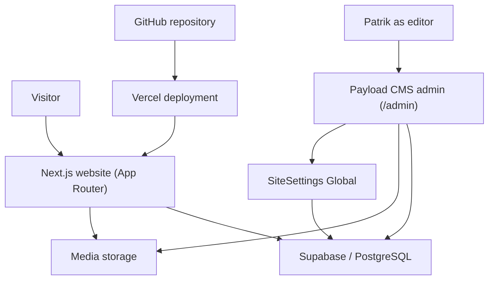
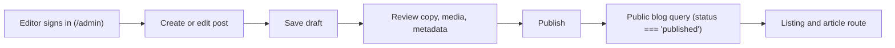
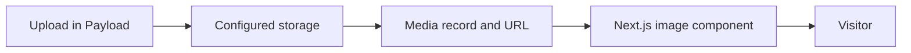
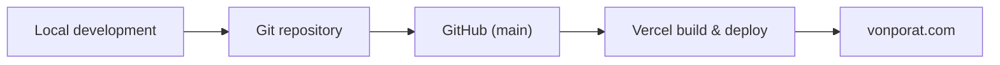

# vonporat.com — Site Architecture

Last reviewed: 2026-10-22

## Purpose

This document describes the information architecture, page responsibilities, system boundaries, content ownership, and data flow for vonporat.com.

It is an architectural map grounded in the actual codebase implementation.

- `AGENTS.md` contains mandatory agent rules and status tables.
- `PROJECT_CONTEXT.md` explains the person, identity, audience, and project meaning.
- `DESIGN_SYSTEM.md` defines visual tokens and presentation rules.
- `CONTENT_GUIDE.md` defines voice, copy, and messaging.
- `TECHNICAL_SYSTEM.md` defines technical configuration, CMS, and operations.
- The repository is authoritative for exact filenames, route implementation, package versions, scripts, schemas, and runtime behavior.

## Confidence labels

- **Established** — a durable project decision or verified live-system fact.
- **Approved** — design and copy reviewed and locked by Patrik.
- **Under review** — implemented but awaiting final user review.
- **Planned** — possible future expansion requiring explicit approval.
- **Verify in repository** — inspect the code before modifying.

## System summary

vonporat.com is a Next.js (App Router, Turbopack) application deployed on Vercel. Payload CMS provides administration, the blog, the gallery, the site settings global, and structured publishing. Supabase/PostgreSQL provides persistent data, settings, and media storage. Three.js powers the interactive homepage background engine (`DigitalSculpture`) with selectable themes. GitHub is the version-controlled deployment source. Google Search Console and Vercel Analytics support visibility and performance review.

High-level system shape:

## Public navigation

Current implemented navigation order (in `src/components/Navbar.js`):

1. **Home** (`/`)
2. **Projects** (`/projects`)
3. **Music** (`/music`)
4. **Art** (`/art`)
5. **Gallery** (`/gallery`)
6. **Blog** (`/blog`)
7. **About** (`/about`)
8. **Contact** (`/contact`)

Projects and Gallery are approved and active in public navigation.

## Route map

| Route | Visibility | Status | Content source | Responsibility |
| --- | --- | --- | --- | --- |
| `/` | Public | Approved & locked | Static composition + SiteSettings background + dynamic latest blog query | Position Patrik and orient visitors through the conceptual journey. |
| `/projects` | Public | Approved & locked | Static composition | Present curated proof cards connecting creative work and systems thinking. |
| `/projects/dmaic-companion` | Public | Approved | Static composition | Case study for the DMAIC Companion web app. |
| `/projects/home-control-panel` | Public | Approved | Static composition | Case study for the Home Assistant control panel. |
| `/music` | Public | Approved & locked | Static composition | Present active music projects, verified discography, roles, and legacy bands. |
| `/art` | Public | Approved & locked | Static composition + interactive client lightbox | Present curated visual and physical practice (graphite, tattoo, miniatures). |
| `/gallery` | Public | Approved & locked | Payload CMS (`gallery-images`, `gallery-albums`, `gallery-categories`) with static fallback (`galleryData.js`) | Present photo albums and build progress in a gallery format. |
| `/blog` | Public | Under review | Payload CMS (`posts` collection) | List published posts with category filters, dynamic lead entry, and text-led cards. |
| `/blog/[slug]` | Public (published) | Outside recent review | Payload CMS (`posts` collection) | Render individual published articles with rich text, media, and metadata. |
| `/about` | Public | Approved & locked | Static composition | Connect music, visual craft, technology, and systems into one personal narrative. |
| `/contact` | Public | Approved & locked | Static composition | Provide direct primary email action and verified external channels. |
| `/admin` | Private | Operational | Payload CMS | Authenticate editors (password or Google sign-in) and manage collections, site settings, the Workbench drafting tool and the analytics dashboard. |
| `/api/*` | Private | Operational | Route handlers | Draft preview (`/api/preview`, `/api/exit-preview`), Google OAuth (`/api/oauth/google`), Workbench AI drafting (`/api/workbench/*`). Disallowed in `robots`. |

## Homepage architecture

The homepage follows the conceptual journey:
**Why → Proof → Expressions → How → Now → Journal → Contact**

Section breakdown:
1. **Hero (Why)**: eyebrow `PATRIK VON PORAT · CREATIVE HUB`, heading `Creative instinct, given structure.`, short introduction, identity line `Guitarist · Visual Artist · Systems-Minded Creator`, CTAs `Explore Selected Work` (`#selected-work`) and `About the Process` (`/about`). Rendered over the Site Settings background theme.
2. **Selected Work (Proof)**: desktop carousel with the centre card in focus (`Realmforged`, `Ashwrithe`, `The Butcher Bust`, `Conan the Barbarian`, `DMAIC Companion`, `Home Control Panel`); stacked on mobile.
3. **Explore by discipline (Expressions)**: `Music & Worlds` (`/music`), `Visual Practice` (`/art`), `Systems & Digital Work` (`/projects`).
4. **How I Work**: `01 OBSERVE`, `02 STRUCTURE`, `03 CREATE`, `04 REFINE`, each with a concrete example.
5. **Currently (Now)**: three linked current-focus items.
6. **Journal**: dynamic query of the latest 3 published posts with graceful fallback.
7. **Closing**: `Follow the work as it develops.` with `Read the Journal`, `Get in Touch`, Instagram and Threads.

### Homepage composition rules
- The hero establishes identity without explaining every individual discipline.
- The introduction adds context rather than repeating the hero title.
- Core expressions route visitors into deeper discipline pages.
- Selected Work provides proof rather than abstract claims.
- Current Focus remains brief, factual, and time-sensitive.
- Journal preview fails gracefully when few or no published posts exist.
- Sections remain independently maintainable without breaking page-level content ownership.

## Page architecture

### Projects (`/projects`)
Curated **Selected Work** showcase:
- **Featured Work**:
  - `Realmforged` (Active): music, worldbuilding, digital experience.
  - `Ashwrithe` (In Development): dark extreme metal, atmosphere, visual identity.
- **Broader Practice**:
  - `DMAIC Companion` (Live · Invite only): guided Lean Six Sigma web app, with case study at `/projects/dmaic-companion`.
  - `Home Control Panel` (In Development): Home Assistant control panel, with case study at `/projects/home-control-panel`.
  - `vonporat.com` (Live): creative hub platform, Next.js, Payload CMS.

### Music (`/music`)
- **Current Projects**: `Realmforged` (Active) and `Ashwrithe` (In Development).
- **Selected Releases**: *Through Ash and Light* (2025), *Echoes of Betrayal* (2025), *Spiritbound* (2025).
- **Selected History**: Freternia (1998–2023) and Cromonic (2014–2017).
- **Guitar timeline**: 35+ years of guitar work and composition.

### Art (`/art`)
Curated visual and physical practice with full-screen lightbox:
- **Traditional Studies**: High-contrast graphite and charcoal studies (e.g. Eye Study).
- **Tattoo Practice**: Reelskin synthetic practice (Skull & Flow, Mario shading).
- **Physical Craft (Miniatures & 3D Prints)**: Painted resin busts (The Butcher, Conan).
- AI-generated imagery is intentionally not shown.

### Gallery (`/gallery`)
Photo gallery driven by Payload CMS (`gallery-categories`, `gallery-albums`, `gallery-images`), including build-progress albums such as Eddie the Trooper. `galleryData.js` provides static fallback data if the CMS is unavailable.

### About (`/about`)
Complete personal narrative connecting creative craft and analytical problem-solving:
- **Hero**: editorial split with *“The work changes. The underlying impulse does not.”* and the introduction beside the studio portrait (portrait under the heading on mobile). No hero buttons.
- **Core Facts band**: `Based in Sweden`, `Playing guitar 35+ years`, `Process Lean Six Sigma Green Belt`, `Current projects Realmforged & Ashwrithe`; 2×2 on mobile.
- **Background**: sticky heading beside the narrative, then the pull quote *“Structure does not replace instinct. It gives instinct somewhere to go.”*
- **Same hands, different materials**: linked triptych (Realmforged, Eye Study, DMAIC Companion).
- **How I Work**: *“From ambiguity to intention.”* as a matrix of the four steps with Music, Visual and Systems examples.
- **Capabilities**: `Music & Audio`, `Visual Practice`, `Systems & Improvement`, `Web & Digital Systems`, equal-height cards linking onward.
- **Closing**: Current chapter with the final calls to action.

### Contact (`/contact`)
Deliberately minimal page laid out as a short personal note:
- **Hero**: `CONTACT` / `Start a conversation.`
- **Introductory copy**: personal and direct.
- **Reasons to write**: Creative collaborations, Music & visual art, Systems & process work.
- **Direct line panel**: Send an Email button (configured `mailto:`), the visible address with a copy button, LinkedIn, Threads and Instagram with the shared handle.
- **Sign-off**: Patrik's signature.
- **No contact form**: Intentionally form-free.

### Blog (`/blog` & `/blog/[slug]`)
Primary CMS-driven journal:
- **Active Categories** (`categories` collection): `Music`, `Visual Art`, `Making`, `Technology`, `Process`, `Personal`, `Projects`.
- **Listing**: Lead entry (`LATEST NOTE`), dynamic category archive headings, and text-led fallback cards for posts without images.
- **Publishing boundary**: Only published posts are publicly rendered; drafts remain protected.

## Content ownership

| Content | Current owner | Storage / Source | Notes |
| --- | --- | --- | --- |
| Page layout and static copy | Repository | React components (`src/app/(app)/`) | Home, Music, Art, Projects, About, Contact. |
| Blog posts | Payload CMS | Supabase / PostgreSQL (`posts`, `categories`) | Only published records are rendered publicly. |
| Gallery | Payload CMS | Supabase / PostgreSQL (`gallery-images`, `gallery-albums`, `gallery-categories`) | `galleryData.js` is a static fallback only. |
| Homepage background | Payload CMS | `site-settings` global | Selected in admin; `?theme=` overrides for preview. |
| Blog media | Payload CMS | Configured storage | Uploaded via Payload admin. |
| Project logos and static imagery | Repository | `public/images/` | Optimized WebP/AVIF/SVG assets. |
| Site metadata | Repository | Next.js Metadata API | Route-specific titles, descriptions, and canonicals. |
| Social/contact channels | Repository | `src/components/ContactLinks.js` | Email CTA and copyable address, plus LinkedIn, Threads and Instagram. |
| Secrets and credentials | Environment | Local `.env` / Vercel Environment Variables | Never tracked in Git or Markdown. |

## CMS boundary

### Established
- Payload CMS is integrated into the Next.js App Router application.
- Supabase/PostgreSQL stores CMS data.
- Blog is the primary CMS-driven public section.
- Gallery is CMS-driven with a static fallback.
- The `site-settings` global selects the homepage background theme.
- Admin authentication protects editorial access (`/admin`).

### Static by default
- Home, Music, Art, Projects (including case studies), About, and Contact.

### Planned, not automatically approved
- Bands collection
- Artwork collection
- Projects collection
- Contact Links collection

## Blog publishing flow

Expected behavior:
- Draft posts remain unavailable to normal public queries.
- Published posts appear on the blog listing and their slug route.
- Category values render consistently.
- Featured imagery resolves correctly on the first visit.
- Invalid or missing slugs return an intentional not-found state.
- Rich text renders through the approved Payload/Lexical renderer.
- Post metadata is generated from the record with sensible fallbacks.

## Media flow

Architectural expectations:
- Media records resolve to valid public URLs when content is public.
- The frontend does not generate `undefined` or incomplete media URLs.
- Above-the-fold featured images load reliably on the first visit.
- Thumbnail, card, hero, and full-view use cases serve appropriate dimensions.
- Remote image hosts are explicitly permitted by Next.js configuration when required.
- Missing media produces a deliberate fallback rather than a broken image.

## Deployment architecture

Expected workflow:
1. Inspect and test locally according to the task level in `AGENTS.md`.
2. Review desktop or mobile behavior where layout or interactive changes are involved.
3. Run relevant checks matching the task scope (e.g. targeted lint for SMALL/MEDIUM; full build for LARGE or pre-deployment).
4. Review the diff before completion.
5. Commit and push only when explicitly requested and authorized by the user.
6. When pushed, Vercel builds and deploys to `vonporat.com`.
7. Verify the live route on `vonporat.com` post-release.

## Environment boundaries

### Local development
Used for implementation, inspection, and verification before release.

### Preview deployment
May be created by Vercel on feature branches. Verify availability and environment scope before relying on it.

### Production
The live environment serving `vonporat.com`. Production data, credentials, storage, and publishing changes require authorization.

## Rendering, caching, and revalidation

Before changing a route, identify:
- Server or client component boundary (`"use client"` vs Server Components)
- Static generation, dynamic rendering, or revalidation intervals (`revalidate = 60`)
- Payload query location (Local API on server)
- Draft/preview bypass
- Error and loading states
- Whether metadata is static or record-driven

## External services and destinations

The site links to verified destinations:
- Streaming & Music: Spotify, YouTube, Bandcamp, Patreon
- Social & Professional: Instagram, Threads, LinkedIn
- Tools: DMAIC Companion (`dmaic.vonporat.com`, invite only)
- Project hubs: Realmforged (`realmforgedofficial.com`), Ashwrithe (`ashwrithe.com`)

These remain external systems. The personal site links to them without duplicating their full internal functionality.

## Failure and fallback behavior

Public routes fail deliberately and readably:
- Missing blog slug &rarr; Custom not-found screen
- Draft post requested publicly &rarr; 404 not-found
- CMS/database temporarily unavailable &rarr; Graceful fallback / static shell
- Missing featured image &rarr; Deliberate text-led card layout
- No published posts &rarr; Friendly empty-state message with reset filter

## Change-impact guide

| Change type | Inspect before implementation |
| --- | --- |
| Navigation | Header, mobile menu, active-state logic, footer, route visibility, sitemap. |
| Homepage section | Section composition, repeated copy, responsive layout, performance, destinations. |
| Blog schema | Payload collection, migration needs, queries, admin UI, rendering, metadata, existing records. |
| Media behavior | Payload Media schema, storage adapter, URL builder, Next.js config, image component, fallbacks. |
| New static page | Route conventions, metadata, navigation approval, shared layout, accessibility. |
| New CMS collection | Proven maintenance need, schema, access control, migration, queries, admin workflow, backups. |
| SEO metadata | Framework metadata implementation, canonical base, Open Graph assets, indexing, sitemap. |
| Deployment | Git state, branch, build command, environment scope, Vercel status, rollback path. |

## Repository discovery checklist

Before using this document to implement a change, verify as relevant:
- [ ] Next.js App Router directory structure (`src/app/(app)/`)
- [ ] Package scripts (`package.json`)
- [ ] Payload configuration (`payload.config.ts`) and collections (`src/collections/`)
- [ ] Database adapter (`@payloadcms/db-postgres`) and storage plugin
- [ ] Blog query and Lexical rich-text rendering code
- [ ] Published/draft access behavior
- [ ] Next.js image remote hosts configuration (`next.config.mjs` / `next.config.ts`)
- [ ] Metadata, sitemap, robots, and canonical URL implementation
- [ ] Current public navigation and route components
