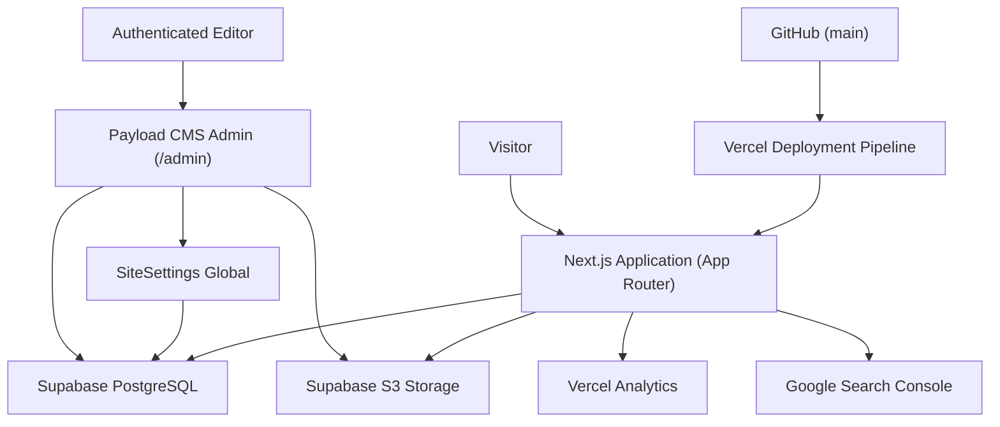
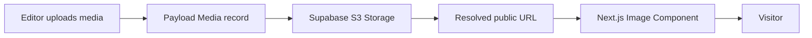

# vonporat.com — Technical System

Last reviewed: 2026-10-17

## Purpose

This document describes the technical architecture, operational boundaries, diagnostics, and development procedures for vonporat.com.

It is grounded in the actual codebase implementation and package configuration.

- `AGENTS.md` contains mandatory rules and current page statuses.
- `SITE_ARCHITECTURE.md` defines routes, page responsibilities, and content ownership.
- `QUALITY_STANDARDS.md` defines QA and verification workflows.
- The repository is authoritative for exact dependencies, file paths, scripts, and runtime behavior.

## Platform overview

| Layer | Technology | Details |
| --- | --- | --- |
| Frontend framework | Next.js 16.2.6 | App Router, Turbopack, React 19.2.4 |
| 3D Graphics engine | Three.js (WebGL) | Interactive 3D digital sculpture background engine with selectable themes |
| CMS engine | Payload CMS v3.85+ | Lexical rich-text editor, Postgres adapter, Local API, Globals |
| Database | Supabase / PostgreSQL | Persistent data storage for Payload CMS collections and site settings |
| Media storage | S3-compatible Supabase Storage | Payload `@payloadcms/storage-s3` plugin |
| Styling | Tailwind CSS v4 | PostCSS plugin, CSS theme variables |
| Hosting & Analytics | Vercel | Automatic deployments on `main`, Vercel Analytics, Speed Insights |
| Source control | GitHub | `xvonpat/patrik-von-porat-portfolio` |
| Search performance | Google Search Console | Indexing, sitemap, and canonical URL monitoring |

## System relationship



## Repository is authoritative

Before performing technical work, inspect the repository rather than relying on assumptions:
- Package manager and lockfile (`package-lock.json` &rarr; `npm`)
- Next.js and Payload versions in `package.json`
- Next.js route tree in `src/app/(app)/`
- Payload configuration in `payload.config.ts`, collections in `src/collections/`, and globals in `src/globals/`
- Database and storage adapter configurations
- Environment-variable names in `.env` and call sites
- Available scripts in `package.json`

## Content ownership boundary

### CMS-driven (Payload CMS)
- **`posts` collection**: Blog articles, titles, slugs, excerpts, rich-text body, categories, published status, publish dates, and cover media.
- **`media` collection**: Uploaded images and media records.
- **`users` collection**: Authenticated administrative users.
- **`site-settings` global**: Configurable site-wide settings including `homepageBackground` (`harmonic-nexus`, `chladni-plate`, `ink-in-water`, `contour-flow`, `alpine-landscape`) with 1-click dashboard controls.

### Repository-managed (Static code)
- Homepage structure and copy (`src/app/(app)/page.js`)
- Projects page (`src/app/(app)/projects/page.js`)
- Music page (`src/app/(app)/music/page.js`)
- Art page and client lightbox (`src/app/(app)/art/`)
- Gallery page (`src/app/(app)/gallery/page.js`)
- About page (`src/app/(app)/about/page.js`)
- Contact page (`src/app/(app)/contact/page.js`, `src/components/ContactLinks.js`)
- Navigation and Footer components (`src/components/`)
- Interactive 3D WebGL sculpture engine (`src/components/digital-sculpture/`)
- Static assets and logos (`public/images/`)

Do not introduce dual ownership where the same value can be edited in both code and CMS without an explicit synchronization design.

## Public routes & navigation

Current implemented navigation order (in `src/components/Navbar.js`):

```text
Home (/) · Projects (/projects) · Music (/music) · Art (/art) · Gallery (/gallery) · Blog (/blog) · About (/about) · Contact (/contact)
```

Verified public routes:
- `/` — Homepage (static composition + dynamic background theme + latest blog query)
- `/projects` — Selected Work proof cards (static composition)
- `/music` — Projects, discography, and legacy bands (static composition)
- `/art` — Visual craft showcases and interactive lightbox (static + client gallery)
- `/gallery` — Visual practice gallery showcase (static composition)
- `/blog` — Journal listing (Payload CMS `posts` collection)
- `/blog/[slug]` — Individual article reader (Payload CMS `posts` collection)
- `/about` — Personal narrative, studio portrait, core facts (static composition)
- `/contact` — Email CTA and external channels (static composition)
- `/contact` — Email CTA and external channels (static composition)

## Private and administrative boundaries

- `/admin` — Private Payload CMS administration panel protected by authentication.
- Authentication endpoints, service routes, and database credentials must never be exposed publicly.
- Never weaken access control or authentication to simplify implementation.

## Payload CMS configuration

### Collection schema: `posts`
The `posts` collection (`src/collections/Posts.ts`) defines:

| Field | Type | Purpose |
| --- | --- | --- |
| `title` | Text | Article title (required). |
| `slug` | Text | Route slug; auto-generated from title if empty. |
| `category` | Select | Active categories: `music`, `visual-art`, `technology`, `process`, `personal`. |
| `publishedDate` | Date | Publication date; auto-set to current time when published if empty. |
| `tags` | Array | Topic tags; auto-suggested from keywords if empty. |
| `status` | Select | `draft` or `published`. |
| `featured` | Checkbox | Featured status for editorial prioritization. |
| `featuredImage` | Upload | Relationship to `media` collection. |
| `excerpt` | Textarea | Summary; auto-generated from first paragraph if empty. |
| `content` | RichText | Lexical rich-text body. |
| `seo` | Group | `seoTitle`, `metaDescription`, `ogImage`, and `canonicalUrl` (auto-populated with fallbacks). |

### Global schema: `site-settings`
The `site-settings` Global (`src/globals/SiteSettings.ts`) controls site-wide runtime configurations:

| Field | Type | Options / Purpose |
| --- | --- | --- |
| `homepageBackground` | Select | `harmonic-nexus` (Default), `chladni-plate`, `ink-in-water`, `contour-flow`, `alpine-landscape`. Governs the active WebGL background sculpture. |

- An interactive admin dashboard card (`src/components/BackgroundThemeDashboardCard.js`) is mounted in the Payload Admin Dashboard, enabling 1-click theme switching with preview thumbnails without requiring a code deployment or rebuild.
- The homepage query (`src/app/(app)/page.js`) fetches the active theme via the Payload Local API with a 60-second revalidation window (`revalidate = 60`), with query-parameter overrides supported for immediate testing (`?theme=nexus`, `?theme=chladni`, `?theme=ink`, `?theme=flow`, `?theme=alpine`).

### Blog query behavior
- Public queries query only published posts (`where: { status: { equals: 'published' } }`).
- Draft posts remain private and are excluded from public sitemaps and listings.
- Featured images resolve to populated media URLs.
- Missing posts or invalid slugs trigger a custom not-found state.

### Lexical rich-text rendering
- Blog bodies use Payload's Lexical editor.
- The frontend renderer handles standard nodes: headings (`h1`–`h4`), paragraphs, lists (ordered/unordered), blockquotes, links, and embedded images.
- Content inherits typography styles defined in the design system.

## Interactive 3D Digital Sculpture Architecture (`DigitalSculpture`)

The hero section background runs a custom Three.js WebGL rendering engine (`src/components/digital-sculpture/`):

- **Theme Registry (`settings.js`)**:
  - `harmonic-nexus` (Default): 3D cymatic guitar strings and a particle attractor around an obsidian core (`harmonic-nexus/scene.js`).
  - `chladni-plate`: Sand on a vibrating plate settling into nodal-line figures, one tone at a time; CPU simulation drawn as three.js points (`chladni/scene.js`).
  - `ink-in-water`: GPU stable-fluids simulation with ink drops blooming in still water; needs half-float render targets, otherwise the background hides itself (`ink/scene.js`).
  - `contour-flow`: River-valley survey. Terrain is evaluated in the vertex shader (meandering channel + rolling fbm hills) and contour lines are drawn per pixel from the interpolated height with `fwidth` anti-aliasing, so they stay hair-thin at any density (`contour/scene.js`). Lines drift slowly downhill and a pulse travels along the valley.
  - `alpine-landscape`: still uses the original marching-squares geometry renderer (`scene.js`, `geometry.js`, `materials.js`).
  - `alpine-landscape`: Sharp high-alpine survey with arête ridges, jagged peaks, and cirque valleys.
- **Dynamic Idle Loading**: Loads asynchronously via `requestIdleCallback` (with 200ms fallback) to guarantee zero blocking of page text, typography, and navigation.
- **Shaders & Blending**: Custom GLSL vertex and fragment shaders using `vertexColors: true`, per-vertex alpha (`aAlpha`), and `THREE.AdditiveBlending` without clipping into white.
- **Readability & Scroll Transition**: A smoothly feathered darkening veil (`readabilityMask`) protects left-hand reading typography; a `--section-calm` CSS variable dynamically fades sculpture contrast and brightness as the visitor scrolls towards *Selected Work*.
- **Performance & Battery Protections**:
  - Automatically pauses the `requestAnimationFrame` render loop when offscreen or when the browser tab is hidden.
  - Respects `prefers-reduced-motion` by freezing camera and pulse animations.
  - Mobile frame rate limiter (`mobileFps: 30`, reduced particle/filament counts).

## Media pipeline



Requirements:
- Featured images resolve reliably on first load.
- Images use appropriate modern formats (WebP, AVIF, SVG, PNG where transparency is required).
- Reserved dimensions prevent unexpected layout shift.
- Media fallbacks ensure posts without featured images render clean text-led layouts.

## Supabase and PostgreSQL

- Connection string configured via environment variables.
- Uses `@payloadcms/db-postgres` adapter with connection pooling.
- Backups and data integrity are managed through Supabase infrastructure.
- Never run destructive raw SQL against production without a verified backup and rollback plan.

## Environment variables and security

Secrets belong exclusively in approved environment stores (`.env` locally, Vercel Environment Variables in production).

Sensitive variables include:
- Database connection strings (`DATABASE_URI` / `POSTGRES_URL`)
- Payload secret (`PAYLOAD_SECRET`)
- S3 / Supabase storage credentials
- OAuth client secrets

### Safe inspection rules
- Check variable presence and names without printing secret values.
- If a credential is accidentally exposed, treat it as compromised, rotate it immediately, update environment stores, and clean tracked content.

## Local development & commands

The repository uses `npm`:

```bash
# Install dependencies
npm install

# Start local development server (Turbopack)
npm run dev

# Run ESLint check on codebase
npm run lint

# Compile production build
npm run build

# Start production server locally
npm run start
```

## Git & Vercel deployment flow

Deployments are triggered only upon explicit user request:
1. Complete local changes and verify behavior according to the task level in `AGENTS.md`.
2. When the user explicitly requests a commit and push to production:
   - Run pre-deployment build validation (`npm run build` and `npm run lint`).
   - Review `git diff` for clean changes and secret safety.
   - Commit and push to `origin/main` as authorized.
3. Vercel automatically builds and deploys to `vonporat.com`.
4. Verify live routes on `https://vonporat.com` post-release.

## Performance baseline & workflow

- **Measurement**: Test desktop and mobile network payloads before and after media changes.
- **Image Optimization**: Serve purpose-sized WebP/AVIF images. Lazy-load below-the-fold media.
- **Layout Stability**: Reserve aspect ratios to maintain low cumulative layout shift (CLS < 0.1).
- **CSS Efficiency**: Restrain heavy backdrop-filters and avoid continuous animation loops.

## Troubleshooting diagnostic paths

- **Post missing from Blog**: Check `status === 'published'`, verify slug, inspect query revalidation cache.
- **Featured image broken**: Verify media relationship population, check Next.js remote image patterns.
- **Build fails**: Check first relevant compile error, inspect server/client import boundaries, verify TypeScript types.
- **Mobile feels slow**: Check unoptimized media, large backdrop-filter areas, or blocking scripts.

## Dependency & migration policies

- Add production dependencies only when the existing stack cannot solve the need clearly.
- Major framework or library upgrades must be planned and tested separately from feature changes.
- Database schema changes should use Payload-supported migrations with verified rollback procedures.

## Technical Definition of Done

A technical task is done when:
1. Requested functionality works as intended.
2. Relevant validation matching the task level in `AGENTS.md` passes (targeted checks for SMALL/MEDIUM; full `npm run build` and `npm run lint` for LARGE or pre-deployment).
3. Responsive layouts are verified when layout changes are introduced.
4. Draft/published and admin security boundaries remain intact.
5. No secrets or credentials appear in code, Markdown, or output.
6. Deployment is verified only when deployment was explicitly requested.
